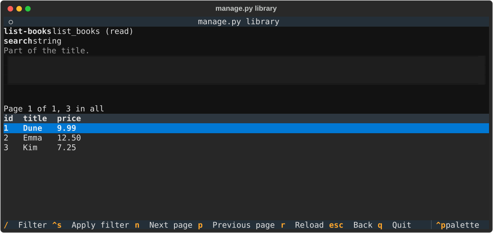

# The terminal screens

`--tui` opens a keyboard-driven app over the command's registry, for an operator who
would rather browse than build a command line. It runs the same specs the subcommands
run, through the same `dispatch`, as the same user. It adds no way to do what the
command line cannot.


## Opening it

```bash
pip install 'django-spec-cli[tui]'
python manage.py notes --tui --as-user 1
```

The screens are built on [Textual](https://textual.textualize.io/), which the `tui`
extra installs (`textual>=8.0.0`); nothing imports it unless `--tui` is passed, so a
project that never uses the screens never needs it.

- **`--as-user USER` is required**, and names the one user every spec on the screens runs
  as. It is looked up once, through
  [`resolve_as_user`][django_spec_cli.spec_command.SpecCommand.resolve_as_user], so a
  project's override applies, and every call goes through `dispatch` as that user.
- **`--tui` takes no spec name and no `--explain`.** Either is a usage error, and so is
  leaving out `--as-user`.
- **Without the extra** the command stops with a message naming it.

## Keys

Each screen's footer shows its main keys; this table lists every key, the ones the footer
leaves out included.

| Screen | Key | Does |
| --- | --- | --- |
| Any | `q` | Quit, except in a text field, where it types a `q` |
| Specs | `up`, `down` or `k`, `j` | Move between specs |
| Specs | `enter` | Open the spec: a list selector as a table, any other as a form |
| Form | `tab`, `shift+tab` | Next and previous field |
| Form | `ctrl+s` | Run the spec; a write needs it twice |
| Form | `esc` | Cancel a write waiting for its second `ctrl+s`, else go back |
| Changelist | `/` | Move to the filter bar |
| Changelist | `enter` in a text field, `ctrl+s` | Run the list again with the filter, from page one |
| Changelist | `n`, `p` | Next and previous page |
| Changelist | `r` | Reload the page |
| Changelist | `enter` on a row | Open the row as JSON |
| Changelist | `a` on a row | List the row's actions |
| Changelist | `esc` | Leave the filter bar for the table, then go back |
| Row | `esc` | Go back |
| Actions | `up`, `down` | Move between actions, skipping greyed ones |
| Actions | `enter` | Open the action's form, the row's values filled |
| Actions | `esc` | Go back to the list |

`n`, `p`, `r` and `a` are typed into a field when one has the focus; press `esc` to return to
the table first.

### Specs

One line per spec the command serves: its subcommand, its name, and whether it reads or
writes. A spec the kernel refuses as declared, the ones `django_spec_cli.W004` reports,
is greyed with the reason and cannot be chosen, as the command line refuses to run it.

### Form


Any spec that is not a list selector opens a form with a field per parameter its
subcommand would take: a choice list for declared choices, a switch for a boolean, a
text area with one value per line for an array, and a text field otherwise.

- **A field left untouched sends nothing**, as an option left off the command line, so
  a default applies. A switch starts at its declared default and is sent once it has been
  toggled; a required one is always sent, as it reads.
- **Values are read by the kernel's `coerce_flat`**, so the form and the command line
  read a value alike. A refused value shows its message below its field, and nothing runs.
- **A read runs on `ctrl+s`.** A write arms on the first `ctrl+s` and says so, and runs on
  the second. Editing any field or pressing `esc` cancels it, so one slip of a key never
  writes.
- **The result** shows as `--table` prints it: "Not found." for a missing row and "Done."
  for nothing. Any other refusal reads as the command prints it, as typed.

### Changelist



A list selector opens as a table. Its columns and cells are the ones `--table` prints for
the same rows: the declared output's fields with the hidden ones left out, a choice's
display, a handle's raw value, compact JSON for a nested value.

- **Rows come a page at a time**, from the kernel's `paginate_output`, 100 to a page. The
  status line says which page of how many and how many rows in all; asking past either
  end stays on the last or first page.
- **The filter bar holds the spec's reads**, filled like the form's fields. `/` moves to
  the first of them; `enter` in a text field or `ctrl+s` runs the list again from page one.
  A refused value, or a refused run, leaves the rows and the filter they came from as
  they were, with the refusal shown.
- **`enter` on a row** opens it as JSON: every key it was presented with, hidden fields
  and `affordances` included, which the table leaves out.

### Actions

`a` on a changelist row lists what that row affords: the `affordances` its list
selector declares, answered by the kernel's `row_links` for the row as it was
presented.

- **Each action names the subcommand it runs.** One the row does not afford is greyed
  with its reason and code, as the row's `affordances` answer them, and cannot be
  chosen. So is one leading to an operation this command does not serve, since the
  screens can only run what the command runs, and one leading to a spec refused as
  declared, with the reason the specs list gives.
- **Choosing one opens that subcommand's form** with the reads the link binds filled
  from the row, a note's `id` into the target's `pk` say, and shown read-only, one no
  field could send included. The
  action runs on the row it was chosen from; the rest of the form is filled as any
  other, and a write still needs its second `ctrl+s`.
- **The operation run is the one the registry holds** under the link's name, so a
  spec swapped in with `replace` runs in place of the one the link was declared with.
- **The row is checked again when it runs.** A row changed since the list loaded, so
  that the action no longer applies, is refused by the kernel with `ActionUnavailable`
  and its reason and code, and nothing is written. A run that is not refused, one
  answering "Not found." included, reloads the list beneath the form, so `esc` returns
  to the rows as they now are.

A link that cannot be bound is a project's declaration error, which the kernel's
`check_links` reports; the screens raise it rather than guess a value.

## Styling

What the screens show is the spec's: the declared output's fields and their labels, which
ones are hidden or a handle, a choice's display, a parameter's help. How they look is a
[Textual stylesheet](https://textual.textualize.io/guide/CSS/) the command names:

```python
class Command(SpecCommand):
    registry = notes_registry
    tui_css = "notes.tcss"
```

```css
ChangelistScreen DataTable { height: 1fr; }
SpecFormScreen #refusal { color: $warning; }
```

- **A relative path is read against the directory of the module declaring the command**,
  as Textual reads an App's `CSS_PATH` beside its module, so `"notes.tcss"` above sits
  next to `management/commands/notes.py`. An absolute path is read where it is.
- **A path that is no file is refused** as `ImproperlyConfigured`, naming the path it
  looked for, before the user is looked up or anything opens.
- **The stylesheet's rules win over the screens' own.** It is the App's stylesheet, and
  each screen's defaults are `DEFAULT_CSS`, which an App's rules override.
- **What a rule can target**: the screens by class, `SpecsScreen`, `SpecFormScreen`,
  `ChangelistScreen`, `RowScreen` and `ActionsScreen`, and Textual's widgets inside
  them (`OptionList`, `DataTable`, `Input`, `Select`, `Switch`, `TextArea`, `Static`),
  plus these ids: `#prompt`, `#refusal`, `#result` and `#file` on the form, `#refusal`
  and `#status` on the changelist, `#row` on the row, `#field-NAME` for a bound field,
  and `#refusal-NAME` (class `refusal`) under each field. These names are the screens'
  structure, not a promise: a release that changes one says so in its changelog.
- Without `tui_css` the screens keep their own look. `tui_css` is read only by `--tui`,
  so a command line run never opens it.

## What the screens do not run

- **A spec whose result is a file.** Its form names the subcommand that writes it,
  `manage.py <command> <subcommand> --as-user USER --output-file PATH`, and runs nothing.
- **A parameter no flat transport can send**, an object or a list of rows. The form says
  which, in a line under the fields, and sends none of them, unless an action binds one
  from its row, which the form then shows read-only and sends.
- **A spec refused as declared**, which is listed greyed.
- **An authorization the command line lacks.** The screens are no more a boundary than
  `manage.py` is: see [what it is not](index.md#what-it-is-not).

To regenerate the pictures above, run `uv run python scripts/tui_screenshots.py docs/img`;
it drives the app with Textual's test pilot over a registry of its own and saves each
screen with `App.save_screenshot()`.
