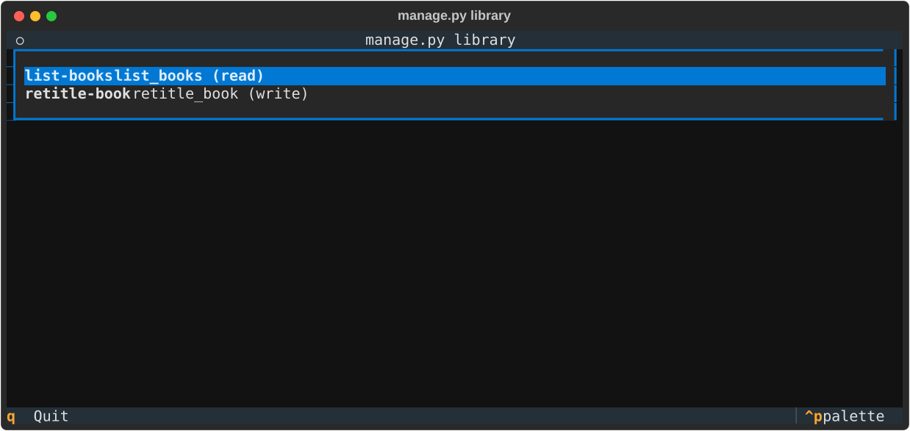
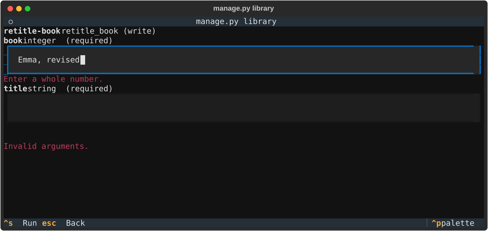

# The terminal screens

`--tui` opens a keyboard-driven app over the command's registry, for an operator who
would rather browse than build a command line. It runs the same specs the subcommands
run, through the same `dispatch`, as the same user. It adds no way to do what the
command line cannot.



## Opening it

```bash
pip install 'django-spec-cli[tui]'
python manage.py notes --tui --as-user 1
```

The screens are built on [Textual](https://textual.textualize.io/), which the `tui`
extra installs (`textual>=8.0.0`); nothing imports it unless `--tui` is passed, so a
project that never uses the screens never needs it.

- **`--as-user USER` is required**, and names the one user every spec on the screens runs
  as. It is looked up once, through
  [`resolve_as_user`][django_spec_cli.spec_command.SpecCommand.resolve_as_user], so a
  project's override applies, and every call goes through `dispatch` as that user.
- **`--tui` takes no spec name and no `--explain`.** Either is a usage error, and so is
  leaving out `--as-user`.
- **Without the extra** the command stops with a message naming it.

## Keys

Every screen's footer lists its keys; this is the same list.

| Screen | Key | Does |
| --- | --- | --- |
| Any | `q` | Quit, except in a text field, where it types a `q` |
| Specs | `up`, `down` or `k`, `j` | Move between specs |
| Specs | `enter` | Open the spec: a list selector as a table, any other as a form |
| Form | `tab`, `shift+tab` | Next and previous field |
| Form | `ctrl+s` | Run the spec; a write needs it twice |
| Form | `esc` | Cancel a write waiting for its second `ctrl+s`, else go back |
| Changelist | `/` | Move to the filter bar |
| Changelist | `enter` in a field, `ctrl+s` | Run the list again with the filter, from page one |
| Changelist | `n`, `p` | Next and previous page |
| Changelist | `r` | Reload the page |
| Changelist | `enter` on a row | Open the row as JSON |
| Changelist | `esc` | Leave the filter bar for the table, then go back |
| Row | `esc` | Go back |

`n`, `p` and `r` are typed into a field when one has the focus; press `esc` to return to
the table first.

### Specs

One line per spec the command serves: its subcommand, its name, and whether it reads or
writes. A spec the kernel refuses as declared, the ones `django_spec_cli.W004` reports,
is greyed with the reason and cannot be chosen, as the command line refuses to run it.

### Form



Any spec that is not a list selector opens a form with a field per parameter its
subcommand would take: a choice list for declared choices, a switch for a boolean, a
text area with one value per line for an array, and a text field otherwise.

- **A field left untouched sends nothing**, as an option left off the command line, so
  a default applies. A switch is sent once it has been toggled.
- **Values are read by the kernel's `coerce_flat`**, so the form and the command line
  read a value alike. A refused value shows its message below its field, and nothing runs.
- **A read runs on `ctrl+s`.** A write arms on the first `ctrl+s` and says so, and runs on
  the second. Editing any field or pressing `esc` cancels it, so one slip of a key never
  writes.
- **The result** shows as `--table` prints it: "Not found." for a missing row and "Done."
  for nothing. Any other refusal reads as the command prints it, as typed.

### Changelist


A list selector opens as a table. Its columns and cells are the ones `--table` prints for
the same rows: the declared output's fields with the hidden ones left out, a choice's
display, a handle's raw value, compact JSON for a nested value.

- **Rows come a page at a time**, from the kernel's `paginate_output`, 100 to a page. The
  status line says which page of how many and how many rows in all; asking past either
  end stays on the last or first page.
- **The filter bar holds the spec's reads**, filled like the form's fields. `/` moves to
  the first of them; `enter` in a field or `ctrl+s` runs the list again from page one.
  A refused value, or a refused run, leaves the rows and the filter they came from as
  they were, with the refusal shown.
- **`enter` on a row** opens it as JSON: every key it was presented with, hidden fields
  and `affordances` included, which the table leaves out.

## What the screens do not run

- **A spec whose result is a file.** Its form names the subcommand that writes it,
  `manage.py <command> <subcommand> --as-user USER --output-file PATH`, and runs nothing.
- **A parameter no flat transport can send**, an object or a list of rows. The form says
  which, in a line under the fields, and sends none of them.
- **A spec refused as declared**, which is listed greyed.
- **An authorization the command line lacks.** The screens are no more a boundary than
  `manage.py` is: see [what it is not](index.md#what-it-is-not).

To regenerate the pictures above, run `uv run python scripts/tui_screenshots.py docs/img`;
it drives the app with Textual's test pilot over a registry of its own and saves each
screen with `App.save_screenshot()`.
